<!-- title: sim: every detector type, program and system feature of the DAQ without hardware; daq_sim matrix runs it all in one command -->
## Motivation

PRs #28-#41 made the lcls2 DAQ run on an S3DF compute node with no hardware: `daq_sim up` brings up control, a TEB, DRPs and a simulated XPM (simxpm) on loopback; `daq_sim cycle` drives a recorded run and checks it with psana2; `daq_sim coverage` lists every detector type the DRPs register and every program the procmgr configs start, and counts a row only from evidence recorded at the commit. At the base (agentify 5aaf09617) 17 detector rows had a hardware-free run (14 `drp` types, 3 `drp_gpu` types); the other types, most programs and the system features did not.

This PR brings the rest. With it, **all 78 coverage rows are RUN, STAND-IN or N/A with evidence at this head (63 RUN, 6 STAND-IN, 9 N/A, 0 unproven)**, and one command, `daq_sim matrix` (RUNBOOK §3p), runs every detector type, the programs, the five system features and the coverage check, and exits 0 only if every named assertion passes.

It merges four branches, each proven and reviewed on its own before (logs cited below), plus the commits where they meet:
- **pr/typesall** (merged at ea351cf89, from 0835d02ab), with **pr/uhrgpu** (cherry-picks 3165ec8ab, 0752cb83c, aacd79f34): the detector types that had no hardware-free run. `drp`: hsd (`Digitizer` on an emulated card, `simhsdioc`), epixquad1kfps, epixUHR, epixuhr3x2 (the C1100 card's CMS mailbox emulated), jungfrau (against `simsls`, a loopback stand-in for the module's slsDetector 9.0.0 servers), epixhr2x2 and tt (their config code needs a third-party library build of the site, `PSDAQ_SIM_PYTHONPATH`, R6). `drp_gpu`: jungfrau and epixuhr3x2 (its calibration web service a loopback stand-in). Now 21 `drp` types and 5 `drp_gpu` types run.
- **pr/stack** (merged at 652c573e3, from dc482a707): the MEB (`monReqServer`, `shmemClient`), AMI (manager, global, node, worker on the MEB, `ami-client` offscreen) checked event by event against psana2, the system DRPs (`drp_pva`, `drp_bld`, `epicsArch`, `drp_udpencoder` with `sim_udpencoder`), the PyQt GUIs and monitors offscreen (`control_gui`, `groupca`, `partca`, `pvant`, `procstat`, `epics_exporter`, `daqstat`), the device GUIs on PV-server stand-ins (`hsdpva`, `pvatable` on simhsd, `tprca` on simtpr, `dtica` on simdti, `xpmpva` and `deadca` on simxpm), the tree's own PV servers (`bldcas`, `hpsdbuscas`), `tprtrig` and `tpr_trigger` on simulated TPR cards; the coverage witnesses that prove a program row; the system features (`daq_sim feature a..e`); one partition over two nodes (`daq_sim up --hosts`); and `daq_sim matrix`.
- **pr/tail3** (merged at 6d0663cee, from 649632d3f): `lclsBldServer` on simulated TPR frames, `hpsBldServer` and `hpsBldCopy` against `simhps` (a stand-in for the HPS crate, R9), and `wave8pvs` in a site conda env with its board emulated (R6b).
- **Where they meet**: ce2bd2cfe and 09f5fe236 (coverage rules of both sides, below), f8f095bc6 (RUNBOOK order), 6bb511313 (`PSDAQ_SIM_PYTHONPATH_<type>`, so tt and epixhr2x2 run from one environment), bfc1ccd3d (`daq_sim matrix --gpu-host`: the `drp_gpu` types on a GPU node beside the others), 5a6387ea1 (a test), fe85cb883 (the matrix runs jungfrau at 100 Hz, its RUNBOOK rate), c370014fc (CHANGELOG links).
- **After review** (three commits on 7695dfdae): d136e1b25 makes `daq_sim up` wait for every `drp_gpu` type's `Ready for transitions` (only epixuhr3x2 waited, so a slow CUDA start on a shared GPU made the others miss control's rollcall); d50c276a7 makes coverage take a record as one run, so another run's files and witness can no longer be added to a record unchanged; b14885af3 adds what a first-time reader of the docs had to guess (below).

**Production code fixed on the way** (each fails on hardware too; base vs head below):
- `ControlDef.MyFloatPv.update` dropped numpy step values, so scans recorded `step_value` 0.0 (a8bda341f).
- `monReqServer` aborted at Disconnect when a DRP dropped its link after the MEB built Unconfigure (47f961e5e, a6087bb1a).
- `drp -D epixhr2x2` and `drp -D tt` aborted at Alloc: neither config script had `<type>_connectionInfo` (99cc4db8d).
- `drp -D tt` aborted at Configure on bracketed config names (`ROI[0]`, `SAD[0]`) an `XtcData::Name` refuses (149eb4dee); an entry written by the old store is now refused at Configure with a message naming the rename, where it hung before (690b84618).
- `epixUHR_config` used an undefined `i` in its per-ASIC gain branches (cb264db88).
- `hpsBldServer` aborted at its first import in any env; `hpsBldCopy` dropped every packet (`HpsEventIterator` left the packet ID 0) (0c465b310).
- `wave8pvs` could not start on rogue 5 or later, or on wave8 1.0.1's `Top` (5519459cd).
- `drp_gpu` crashed on a Reset after a Disconnect (8909224b8), and `drp_gpu -D jungfrau` wrote a second `Names` that psana refuses (346ba480c); psana could not read what `drp_gpu -D epixuhr3x2` records (3165ec8ab).
- `lclsBldServer` gets `-a`/`-p` options (defaults unchanged: the production groups and port), so a run can use non-production groups (040db9265).

The rest of the diff is under `psdaq/psdaq/sim`, tests, docs, and the `-d sim://` paths of the DRPs (`MemPoolSim`, the timing of `drp_pva`, `drp_bld`, `epicsArch`, `drp_udpencoder`), which a hardware run does not take (the hardware path below shows the same behavior at base and head).

## How to test the behavior?
```
# S3DF: two milano nodes A, B of one Slurm job (JOB), a GPU node G whose driver runs CUDA 12.9 (GJOB), a checkout of this head.
# RUNBOOK.md (psdaq/psdaq/sim) section 1 for the setup; 3h for the CUDA toolkit (conda-forge's 12.9 when the node has none).
# Build on G (drp_gpu needs nvcc; a milano node cannot link it):
srun --jobid=$GJOB --overlap -w G --ntasks=1 --cpus-per-task=16 --mem=32G bash -c \
  "source setup_env_daq.sh && export CUDA_ROOT=$CUDA PATH=\$PATH:$CUDA/bin && ./build_all.sh -d -j 12; echo BUILD_EXIT=\$?"
# Unit tests (one step, the node's DAQ lock held):
source setup_env_daq.sh && source psdaq/psdaq/sim/sim_env.sh
python -m pytest -q psdaq/psdaq/tests/test_sim*.py psdaq/psdaq/webgui/tests/test_walk_guard.py    # 420 passed, 1 skipped
# THE matrix: one step on A (RUNBOOK 3p, "Everything, over every node of the campaign"; mx.sh in the assets is this run's copy):
srun --jobid=$JOB --overlap -w A --ntasks=1 --cpus-per-task=16 --mem=32G bash mx.sh h2 G $GJOB
#   = daq_sim matrix -w $WD --hosts A,B --locks LOCK_A,LOCK_B --gpu-host G --gpu-job $GJOB --gpu-gres gpu:l40s:1 \
#       --gpu-lock LOCK_G --ami-src <AMI source tree> --evidence $EV --lock-timeout 5400
#   with DAQ_SIM_CUDA_LIB, PSDAQ_SIM_WAVE8PVS_ENV/_SRC, PSDAQ_SIM_PYTHONPATH_tt and _epixhr2x2 set, no plain PSDAQ_SIM_PYTHONPATH
#   -> MATRIX PASS (201 assertions), MATRIX_EXIT=0 when every assertion passes (at this head h1 failed 3 and h2 1 of 201:
#      see Proof); one TYPE line per type (26), PROGRAMS, FEATURE a..e, coverage: 78 rows, 63 run, 6 stand-in, 9 N/A, 0 unproven
# Coverage negative: a copy of $EV without the records that list det:drp:epix100
daq_sim coverage --evidence <copy>; echo $?      # det:drp:epix100 RUN NO VALID EVIDENCE at HEAD ...; 1
# The three deliberate breaks (each must exit 1 and name the failed assertion):
for k in register kill-drp corrupt; do daq_sim matrix -w $WD/brk --break $k --lock LOCK_A; echo $?; done
# The web GUI: daq_sim up --webgui -w $WD (RUNBOOK 3b), then from your machine a tunnel to 127.0.0.1:31053 of the node
```

## Proof it works

Ran on S3DF at **b14885af349db9d58d24f6a5670e925286b3737b** (pr/final, this PR's head: 7695dfdae plus three commits, committed 2026-11-10 03:28:49Z), on 2026-11-10 03:29-04:58 UTC: sdfmilan023 and sdfmilan082 (milano, Slurm job 44000948), the GPU DRP's types on sdfada010 (run h1, job 44062096) and sdfada013 (run h2, job 43970564), one NVIDIA L40S each. Steps: the build (sdfada010 step 1), the unit tests (sdfmilan082 steps 344 and 347), matrix run h1 (sdfmilan023 step 350), the breaks (sdfmilan023 step 366), matrix run h2 (sdfmilan023 step 367), the coverage negatives and forgeries (sdfmilan023), CUDA init timings (sdfada010 steps 3 and 5, sdfada013 step 283). The DAQ env was `daq_20250402_r9` (Python 3.9.21); every script sources `setup_env_daq.sh` and then `sim_env.sh` ([scripts](https://github.com/carbonscott/lcls2/tree/pr-assets/pr42/scripts), [this run's](https://github.com/carbonscott/lcls2/tree/pr-assets/pr42/scripts/fix15)).

> **Result: THE matrix did not exit 0 at this head, but each of its 201 assertions passed in one of its two runs here.** Run h2 (GPU types on sdfada013): `MATRIX FAIL (1 of 201 assertions failed)`, `MATRIX_EXIT=1`. All 21 `drp` and all 5 `drp_gpu` types, the programs run, features a, b, d, e and coverage passed: **`78 rows, 63 run, 6 stand-in, 9 N/A, 0 unproven, 0 claimed without valid evidence`**. Feature c failed only on `MEB_EvtCt None: the MEB served no event`: the matrix read none of the MEB's Prometheus counters after Disable (one read, 3 s timeout), while the MEB did serve (shmemClient took 1060 L1Accepts from it; AMI, on the MEB, matched 1050 of 1050 events with psana2). Feature c passed in run h1 (`MEB_EvtCt` 2422) and in 3 runs of `daq_sim feature c` alone at this head (sdfmilan082 step 373: `MEB_EvtCt` 2321, 2200, 2219; [out](https://github.com/carbonscott/lcls2/blob/pr-assets/pr42/logs/h2/fc-diag.out)). Run h1 (GPU types on sdfada010) failed 3 of 201, all `drp_gpu` jungfrau (UDP packets of 5 frames lost on loopback) and its coverage row; jungfrau passed in h2. No code changed between h1 and h2; h2 ran the GPU types on sdfada013, where CUDA starts slowly and d136e1b25's wait was needed (below). The plan allowed one rerun after a run whose only failures were GPU rows; h2 was it.

**The head.** b14885af3 is pr/final's last commit; the base is agentify at 5aaf09617737887aef5f196f13754d7ad6f6b98c (the merge of #41), still origin/agentify. The diff against it is 99 files (16016 insertions, 371 deletions) in 150 commits (129 not merges). Since 7695dfdae: d136e1b25, d50c276a7, b14885af3, 7 files (`daq_sim.py`, `coverage.py`, their tests, `RUNBOOK.md`, the web GUI's `README.md`, `CHANGELOG.md`: 223 insertions, 45 deletions; recording 3 shows `git diff --stat 7695dfdae HEAD`). The checkout had 0 local changes (tracked or untracked) before and after each recording.

**Build and unit tests.** `build_all.sh -d -j 12` with conda-forge's CUDA 12.9 `nvcc` on PATH at b14885af3 on sdfada010 (step 1): `BUILD_EXIT=0`, `ninja: no work to do.` (no C++ changed since the CUDA build at c370014fc), `psdaq` reinstalled, the installed `psdaq/sim`, `webgui`, `control` and `configdb` identical to the checkout, `install/bin/drp_gpu` and 8 GPU libraries ([out](https://github.com/carbonscott/lcls2/blob/pr-assets/pr42/logs/fix15/build-H.out), [log](https://github.com/carbonscott/lcls2/blob/pr-assets/pr42/logs/fix15/build-H.log)). The sim unit tests and `test_walk_guard` (AMI on `PYTHONPATH`, under sdfmilan082's DAQ lock): **`420 passed, 1 skipped`, `PYTEST_EXIT=0`** (step 344, 216 s, [out](https://github.com/carbonscott/lcls2/blob/pr-assets/pr42/logs/fix15/pyt-H.out); again in recording 3, step 347). The 3 new tests fail on 7695dfdae's code, run against this head's tests ([pyt-old.out](https://github.com/carbonscott/lcls2/blob/pr-assets/pr42/logs/fix15/pyt-old.out): the FG3 splice is accepted, `fakecam` has no `ready_s`).

**THE matrix** (RUNBOOK §3p, "Everything, over every node of the campaign"; [`mx.sh`](https://github.com/carbonscott/lcls2/blob/pr-assets/pr42/scripts/fix15/mx.sh), proof15's with only its output dir changed), one command in one step on sdfmilan023:

```
daq_sim matrix -w $F/mx-$TAG --hosts sdfmilan023,sdfmilan082 \
  --locks /tmp/agentify-daq-milan023.lock,/tmp/agentify-daq-milan082.lock \
  --gpu-host sdfada013 --gpu-job 43970564 --gpu-gres gpu:l40s:1 --gpu-lock /tmp/agentify-daq-ada013.lock \
  --ami-src /sdf/group/lcls/ds/ana/sw/conda2/rel/ami_091526 --evidence $DAQ_SIM_EVIDENCE --lock-timeout 5400
# env: DAQ_SIM_CUDA_LIB (CUDA 12.9), PSDAQ_SIM_WAVE8PVS_ENV=ps-4.5.16, PSDAQ_SIM_WAVE8PVS_SRC=wave8-1.0.1.tar.gz,
#      PSDAQ_SIM_PYTHONPATH_tt, PSDAQ_SIM_PYTHONPATH_epixhr2x2; no plain PSDAQ_SIM_PYTHONPATH; a new, empty evidence dir per run
```

| run | HEAD | GPU node | time (UTC) | result | failed assertions |
|---|---|---|---|---|---|
| m1 (recording 1) | c370014fc at start; 7695dfdae from 02:01:50Z | sdfada013 | 01:41:49-02:14:58 | `MATRIX FAIL (15 of 201 assertions failed)`, exit 1 | epixquad1kfps (5): its DRP aborted 1 s into Running, `TebContributor::_post: _pending queue overflow` ([log](https://github.com/carbonscott/lcls2/blob/pr-assets/pr42/logs/m1/drp-epixquad1kfps-m1.log)); drp_gpu epixuhremu (5): Configure did not complete in 60 s, then teb0 segfaulted in libfabric at Disconnect ([drp_gpu](https://github.com/carbonscott/lcls2/blob/pr-assets/pr42/logs/m1/drp_gpu-epixuhremu-m1.log)); drp_gpu jungfrau (4): no answer to rollcall, its log stops at `Global memory: 45457 MB` ([log](https://github.com/carbonscott/lcls2/blob/pr-assets/pr42/logs/m1/drp_gpu-jungfrau-m1.log)); coverage: 23 rows recorded at c370014fc |
| m2 (recording 2) | 7695dfdae | sdfada013 | 02:20:30-02:48:43 | `MATRIX FAIL (13 of 201 assertions failed)`, exit 1 | drp_gpu fakecam, epixuhremu, jungfrau (4 each): `drp/<type>_0 did not respond to rollcall` ([fakecam](https://github.com/carbonscott/lcls2/blob/pr-assets/pr42/logs/m2/drp_gpu-fakecam-m2.log): its log reaches `Output dir: ready` after the rollcall); coverage: those 3 rows |
| h1 (recording 3) | b14885af3 | sdfada010 | 03:38:33-04:08:04 | `MATRIX FAIL (3 of 201 assertions failed)`, exit 1 | drp_gpu jungfrau per-event and evidence (UDP packets of 5 frames lost on loopback; `DRP_Damage 5`); coverage: that row ([log](https://github.com/carbonscott/lcls2/blob/pr-assets/pr42/logs/h1/mx-h1.log)) |
| **h2 (recording 4)** | b14885af3 | sdfada013 | 04:24:25-04:48:56 | `MATRIX FAIL (1 of 201 assertions failed)`, exit 1 | features/c: `MEB_EvtCt None: the MEB served no event` (no MEB counter read; shmemClient 1060 L1Accepts, AMI 1050 of 1050 matched) ([log](https://github.com/carbonscott/lcls2/blob/pr-assets/pr42/logs/h2/mx-h2.log), [summary](https://github.com/carbonscott/lcls2/blob/pr-assets/pr42/matrix-summary-b14885af3.json)); every type and coverage passed |

**Why m2's GPU types failed, and the fix** (a reviewer's finding, D2). drp_gpu says `Ready for transitions` only after its CUDA start (cuInit, the context, its DMA buffers) and its detector's init, and control's rollcall finds only a DRP that has. `daq_sim up` waited for that line only where a type set `ready_s`, which among the GPU types only epixuhr3x2 did (since 6cc7f3e95). On sdfada013 the GPU is shared with another user's GPU jobs and its persistence mode is off: `cuInit` took 28.4, 35.8 and 1.6 s in fresh processes at 02:30Z, 0.1, 1.6 and 37.1 s at 02:53Z ([1](https://github.com/carbonscott/lcls2/blob/pr-assets/pr42/logs/cuinit-ada013.log), [2](https://github.com/carbonscott/lcls2/blob/pr-assets/pr42/logs/cuinit-ada013-2.log)), and 10.25, 1.55 and 28.50 s at 04:23Z (recording 4). d136e1b25 gives every `GPU_SIM_TYPES` entry `ready_s` (300 s) and a `ready_why` that its timeout prints; `up` now prints how long each DRP took. In h2 on sdfada013: each drp_gpu said `Ready for transitions` after fakecam 31 s, epixuhremu 20 s, epixuhrsim 7 s, jungfrau 20 s, epixuhr3x2 73 s, and `up` waited for it; on sdfada010 (persistence on, `cuInit` 0.06-0.08 s, [log](https://github.com/carbonscott/lcls2/blob/pr-assets/pr42/logs/fix15/cuinit-ada010.log)) 0 to 2 s, and 51 s for epixuhr3x2, whose readout system's init takes about 40 s. The GPU nodes: sdfada011's L40S fails `cuInit` with error 999 (a GPU step there at 02:20:19Z), so it ran only CPU DAQs (the web GUI run below) and its job ended at 03:03Z; sdfada013 is shared and slow to start CUDA; sdfada010, allocated at 03:04Z, is fast. h1 used sdfada010 and h2 sdfada013, the one rerun the plan allowed after a run whose only failures were GPU rows.

**Per type, run h2 at b14885af3** (each type on a fresh DAQ: `daq_sim up --det <T> --detach`, one recorded cycle of 1000 L1Accepts or more, `down`; `--rate 100` for jungfrau). DAQ is simxpm's L1Accepts, TEB_WrtCt the TEB's recorded events, then psana2's events and its events with the type's data; the per-event check is `xtc2_check --det <T>` (`--drp drp_gpu` for the GPU DRP), which compares every event's data, through the type's own psana interface, with what the simulated device was set to send. The last two columns are the DAQ counts of h1 (at b14885af3) and m2 (at 7695dfdae). [matrix-summary-b14885af3.json](https://github.com/carbonscott/lcls2/blob/pr-assets/pr42/matrix-summary-b14885af3.json) (= h2), [per-type-b14885af3.md](https://github.com/carbonscott/lcls2/blob/pr-assets/pr42/per-type-b14885af3.md), [h1](https://github.com/carbonscott/lcls2/blob/pr-assets/pr42/matrix-summary-h1.json), [m2](https://github.com/carbonscott/lcls2/blob/pr-assets/pr42/matrix-summary-m2.json), [full log h2](https://github.com/carbonscott/lcls2/blob/pr-assets/pr42/logs/h2/mx-h2.log):

| type | DRP | node | DAQ | TEB_WrtCt | psana2 | with data | per-event | evidence record (h2) | h1 | m2 |
|---|---|---|---|---|---|---|---|---|---|---|
| fakecam | drp | milan023 | **1913** | 1913 | 1913 | 1913 | PASS | `20261109T202511-cycle-b14885af3-1553275` | 1852 | 1794 |
| cspad | drp | milan082 | **1870** | 1870 | 1870 | 1870 | PASS | `20261109T202511-cycle-b14885af3-1785471` | 1828 | 1821 |
| hsd | drp | milan023 | **1932** | 1932 | 1932 | 1932 | PASS | `20261109T202610-cycle-b14885af3-1555362` | 2812 | 2836 |
| epixquad | drp | milan082 | **1859** | 1859 | 1859 | 1859 | PASS | `20261109T202616-cycle-b14885af3-1787545` | 1811 | 1877 |
| epixquad1kfps | drp | milan023 | **1713** | 1713 | 1713 | 1713 | PASS | `20261109T202716-cycle-b14885af3-1557434` | 1852 | 1909 |
| epixhr2x2 | drp | milan082 | **1765** | 1765 | 1765 | 1765 | PASS | `20261109T202723-cycle-b14885af3-1789611` | 1821 | 2846 |
| epixhremu | drp | milan023 | **1811** | 1811 | 1811 | 1811 | PASS | `20261109T202809-cycle-b14885af3-1559523` | 1939 | 2932 |
| epixm320 | drp | milan082 | **1792** | 1792 | 1792 | 1792 | PASS | `20261109T202830-cycle-b14885af3-1791847` | 1823 | 1961 |
| epixUHR | drp | milan023 | **1812** | 1812 | 1812 | 1812 | PASS | `20261109T202932-cycle-b14885af3-1561091` | 1847 | 1915 |
| epix100 | drp | milan082 | **2826** | 2826 | 2826 | 2826 | PASS | `20261109T202933-cycle-b14885af3-1794453` | 1917 | 1937 |
| jungfrau | drp | milan023 | **1092** | 1092 | 1092 | 1092 | PASS | `20261109T203046-cycle-b14885af3-1564020` | 1102 | 1100 |
| jungfrauemu | drp | milan082 | **1775** | 1775 | 1775 | 1775 | PASS | `20261109T203101-cycle-b14885af3-1796028` | 1894 | 1996 |
| opal | drp | milan023 | **2242** | 2242 | 2242 | 2242 | PASS | `20261109T203154-cycle-b14885af3-1566385` | 2654 | 2107 |
| tt | drp | milan082 | **1809** | 1809 | 1809 | 1809 | PASS | `20261109T203156-cycle-b14885af3-1799076` | 1823 | 1892 |
| tb | drp | milan023 | **1790** | 1790 | 1790 | 1790 | PASS | `20261109T203246-cycle-b14885af3-1568686` | 1913 | 2005 |
| ts | drp | milan082 | **1780** | 1780 | 1780 | 1780 | PASS | `20261109T203248-cycle-b14885af3-1801003` | 1805 | 1889 |
| wave8 | drp | milan023 | **1770** | 1770 | 1770 | 1770 | PASS | `20261109T203344-cycle-b14885af3-1570578` | 1822 | 2039 |
| wave8he | drp | milan082 | **2820** | 2820 | 2820 | 2820 | PASS | `20261109T203349-cycle-b14885af3-1802930` | 1823 | 1862 |
| hrencoder | drp | milan023 | **2853** | 2853 | 2853 | 2853 | PASS | `20261109T203439-cycle-b14885af3-1572645` | 1900 | 1955 |
| piranha4 | drp | milan082 | **1815** | 1815 | 1815 | 1815 | PASS | `20261109T203444-cycle-b14885af3-1805000` | 1841 | 1922 |
| epixuhr3x2 | drp | milan023 | **1884** | 1884 | 1884 | 1884 | PASS | `20261109T203635-cycle-b14885af3-1575981` | 2222 | 1893 |
| fakecam | drp_gpu | ada013 | **1793** | 1793 | 1793 | 1793 | PASS | `20261109T202602-cycle-b14885af3-3001204` | 2825 | **FAIL** |
| epixuhremu | drp_gpu | ada013 | **2700** | 2700 | 2700 | 2700 | PASS | `20261109T202734-cycle-b14885af3-3005054` | 2750 | **FAIL** |
| epixuhrsim | drp_gpu | ada013 | **2731** | 2731 | 2731 | 2731 | PASS | `20261109T202843-cycle-b14885af3-3008356` | 1756 | 1860 |
| jungfrau | drp_gpu | ada013 | **1082** | 1082 | 1082 | 1082 | PASS | `20261109T203034-cycle-b14885af3-3011808` | **FAIL** | **FAIL** |
| epixuhr3x2 | drp_gpu | ada013 | **1672** | 1672 | 1672 | 1672 | PASS | `20261109T203304-cycle-b14885af3-3018417` | 1882 | 1797 |
| **programs run** (fakecam_0 + the MEB, AMI, system DRPs, GUIs, PV servers) | drp | milan023 | **1750** | 1750 | 1750 | 1750 | PASS | `20261109T203837-cycle-b14885af3-1579403` (42 rows) | 3310 | 2417 |

In h2 every type has `up` exit 0, 14 transitions reset .. running .. reset each read back with no error message, its DRP alive after the run, `down: clean`, and an evidence record coverage accepts.

**Programs** (h2: one DAQ with the MEB and AMI, `--pva --epics --udp --gui --pvservers --tpr --hps --wave8pvs --rate 100`): `programs/checks`: `system DRP checks: PASS; ami check: PASS; gui witness: PASS; ami shot: PASS ami-shot.png: window "fakecam:raw:raw" of ami-client pid 1580159, 65+ colours; MEB_EvtCt 1750`. Its record lists 42 rows, each accepted by coverage: `det:drp:fakecam`; `ami-client`, `ami-global`, `ami-manager`, `ami-node`, `ami-worker`; `monReqServer`, `shmemClient`; `drp_pva`, `epicsArch`, `drp_udpencoder`, `sim_udpencoder`; `control`, `drp`, `teb`; `control_gui`, `groupca`, `partca`, `pvant`, `procstat`, `epics_exporter`, `daqstat`; `hsdpva`, `pvatable`, `tprca`, `dtica`, `xpmpva`, `deadca`; `bldcas`, `hpsdbuscas`; `tprtrig`, `tpr_trigger`, `lclsBldServer`, `hpsBldServer`, `hpsBldCopy`, `wave8pvs`; the STAND-IN rows `pyxpm`, `pykcuxpm`, `hsdpvs`, `hsd134PVs`, `tprcas`, `tprioc`. (`drp_bld` is proven by feature e.) AMI's own viewer of the camera while Running:

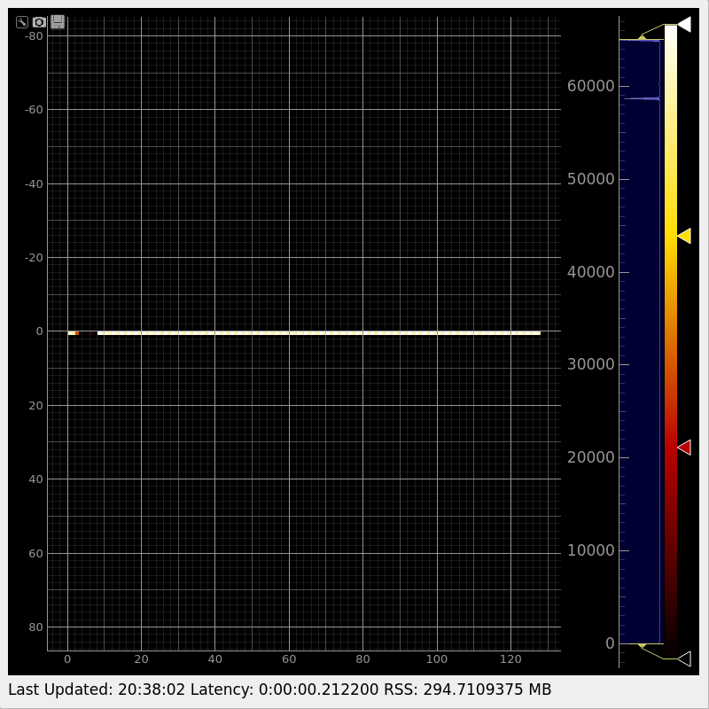

**Features** (each `daq_sim feature <x>` on its own DAQ, report with job 44000948 step 367, host, HEAD b14885af349db9d58d24f6a5670e925286b3737b, files changed 0):
- **a** PASS: three DRP types in two readout groups at different rates: group 5 at 1.02 kHz: 1813 L1Accepts, group 6 at 102 Hz: 182 L1Accepts; hrencoder_0 (group 5) 1813 = 1813 = 1813; epix100_0 (group 6) 182 = 182 = 182; wave8_0 (group 6) 182 = 182 = 182; each per-event check PASS.
- **b** PASS: a three-step scan (`generic_timing_scan.py` over `epix100_0:user.start_ns`): tb_0 and epix100_0 600 events each, [200, 200, 200] per step; psana2 reads `step_value` 700000.0, 710000.0, 720000.0 (a8bda341f).
- **c** FAIL in h2, PASS in h1: the MEB serving AMI. h2: fakecam_0 2121 = 2121, shmemClient 1060 L1Accepts from the MEB, AMI matched 1050 of 1050 (seq 4..2102), but `problem: MEB_EvtCt None: the MEB served no event` (no MEB counter in the counts read after Disable) ([AMI's viewer](https://raw.githubusercontent.com/carbonscott/lcls2/pr-assets/pr42/ami-shot-h2-feature-c.png)). h1: (step 350) fakecam_0 2422 = 2422, `MEB_EvtCt` 2422, shmemClient 1210 L1Accepts; AMI matched 1200 of 1200 events it computed against psana2 (seq 17..2415).
- **d** PASS: one partition over two nodes: fakecam_0 on sdfmilan023 and fakecam_1 on sdfmilan082, 1097 = 1097 each.
- **e** PASS: drp_bld, drp_pva, drp_udpencoder and epicsArch beside fakecam_0: 1087 L1Accepts each; bld 1087 matched, 0 missing; udp 1087 matched; pva 1085 matched, 2 L1Accepts without an image (seq 568, 569; the check counts them and drp_pva's own count agrees); epics 1087.

**Coverage at b14885af3** (h2's evidence): `at b14885af3: 78 rows, 63 run, 6 stand-in, 9 N/A, 0 unproven, 0 claimed without valid evidence`. Every RUN and STAND-IN row has a record made at b14885af3, and each N/A row prints its reason ([covpos-h2.log](https://github.com/carbonscott/lcls2/blob/pr-assets/pr42/logs/h2/covpos-h2.log) lists each row with its record or reason).

**Negatives, forgeries and breaks at b14885af3.**
- **Coverage negative** ([`covneg.sh`](https://github.com/carbonscott/lcls2/blob/pr-assets/pr42/scripts/fix15/covneg.sh)): in a COPY of h2's 32 records, the 3 that list `det:drp:epix100` removed: `det:drp:epix100 RUN NO VALID EVIDENCE at HEAD b14885af3`, `78 rows, 62 run, 6 stand-in, 9 N/A, 0 unproven, 1 claimed without valid evidence`, exit 1; over h2's evidence itself: exit 0 ([covneg-h2.log](https://github.com/carbonscott/lcls2/blob/pr-assets/pr42/logs/h2/covneg-h2.log), [covpos-h2.log](https://github.com/carbonscott/lcls2/blob/pr-assets/pr42/logs/h2/covpos-h2.log)). The same over h1's records (recording 3): exit 1 naming `det:drp:epix100` ([covneg-h1.log](https://github.com/carbonscott/lcls2/blob/pr-assets/pr42/logs/h1/covneg-h1.log)).
- **Forgeries by record edits only** ([`forge.sh`](https://github.com/carbonscott/lcls2/blob/pr-assets/pr42/scripts/fix15/forge.sh), with a reviewer's `fg23.py` and `fg1.py`; no file written, no hash computed; coverage over each record alone; [own](https://github.com/carbonscott/lcls2/blob/pr-assets/pr42/logs/h2/forge-own.log), [FG2](https://github.com/carbonscott/lcls2/blob/pr-assets/pr42/logs/h2/forge-fg2.log), [FG3](https://github.com/carbonscott/lcls2/blob/pr-assets/pr42/logs/h2/forge-fg3.log), [FG1](https://github.com/carbonscott/lcls2/blob/pr-assets/pr42/logs/h2/forge-fg1.log)). MINE is h2's programs record, OTHER the programs record of another run (finalinteg's, at 29f1be4a7):
  - MINE alone: the program rows are RUN (`prog:groupca`, `tprtrig`, `tpr_trigger`, `lclsBldServer`, `hpsBldServer`, `hpsBldCopy`, `wave8pvs` ... `evidence 20261109T203837-cycle-b14885af3-1579403`).
  - FG2, MINE with its witness swapped for OTHER's: rejected, `its gui_witness witness names no listed xtc2 file of run tstx00001/r0001`.
  - **FG3**, FG2 plus OTHER's 4 xtc2 files and 7 program logs, unchanged: at c370014fc six rows were accepted (tprtrig, tpr_trigger, lclsBldServer, hpsBldServer, hpsBldCopy, wave8pvs). **Now every row is rejected**: `its xtc2 files of run tstx00001/r0001 have 2 different BeginRuns (1163120920.815554022, 1163133458.539332171): a record is one run, so it cannot list another run's files` (d50c276a7, D3).
  - **FG1 still passes**: OTHER with only its `sha` field changed to b14885af3 is accepted for all its 42 rows (`78 rows, 36 run, 6 stand-in, ...`). Records are not signed (COV-LIMIT, below).
- **Breaks** (recording 3, `daq_sim matrix --break <k>`, sdfmilan023 step 366, at b14885af3; [`brk.sh`](https://github.com/carbonscott/lcls2/blob/pr-assets/pr42/scripts/fix15/brk.sh), [logs](https://github.com/carbonscott/lcls2/tree/pr-assets/pr42/logs/h1)), each exit 1 naming the assertions:
  - `register`: `MATRIX FAIL (5 of 7 assertions failed)`: `types/epix100/transitions` (`epix100_0 did not respond to configure`; `rogue_dev: FAULT ePixBoard.ePix100aFPGA.EpixFpgaRegisters.DaqTriggerDelay ... reads back 0x7fffffff`), `drp-alive`, `counts`, `per-event`, `evidence`.
  - `kill-drp`: `MATRIX FAIL (5 of 7)`: `types/fakecam/drp-alive` (`GONE after the run`), `transitions` (`fakecam_0 did not respond to disable`), `counts` (simxpm 1817, psana2 0), `per-event` (file empty), `evidence`.
  - `corrupt`: `MATRIX FAIL (2 of 7)`: `types/fakecam/per-event` (`event 500: payload pattern broken: 1 of 60 payload words differ, first lane 0 w32 0xa8d35fb5 != 0xa8d35f4a`), `evidence`; every count agreed.

**Hardware path, base 5aaf09617 vs this head** (no simulated device: the commands a hardware run takes). The union of every branch's base-vs-head script, `hwall.sh`, ran in one GPU step on sdfada013 (job 43970564 step 268, 01:35-01:52Z, under the node's lock) with the base worktree at 5aaf09617 and this checkout at c370014fc. Since c370014fc only `CHANGELOG.md` (7695dfdae) and, at this head, `psdaq/psdaq/sim`, its tests and two docs changed, none of which a hardware run takes, so it was not run again. Each script's output, base against head, with the first and last line (host, time) left out ([hwall15.log](https://github.com/carbonscott/lcls2/blob/pr-assets/pr42/logs/hwpath/hwall15.log), [all outputs](https://github.com/carbonscott/lcls2/tree/pr-assets/pr42/logs/hwpath)):

| script (branch) | what it runs at base and head | diff |
|---|---|---|
| `typesfix/hw.sh` | every `drp` type's python entry points and `drp -D <type>` on `/dev/datadev_0`; `drp_gpu` likewise (GPU step) | none (309 lines each) |
| `uhrgpu/hw.sh`, `uhr3x2/hwpath.sh`, `iter11-stack/hwpath.sh` | `drp_gpu -D epixuhr3x2` on `/dev/datadev_0`; 17 types' `<type>_init` and `drp -D <type>` on `/dev/datadev_0`; `drp` (also with `PSDAQ_SIM_CORRUPT_SEQ` set), `drp_bld`, `drp_pva`, `epicsArch`, `drp_udpencoder`, `sim_udpencoder` and `monReqServer` on their hardware options | none (317, 222, 62 lines) |
| `typesfix/hwx.sh` | epixhr2x2's entry points | `epixhr2x2_connectionInfo` added (99cc4db8d) |
| `typesfix/tthw.sh` | tt's entry points; the config DB entry `tt_config_store` writes; `drp -D tt -d /dev/datadev_0` (aborts at the missing device at both) | `tt_connectionInfo` added (99cc4db8d); stored names `ROI0`, `ROI1`, `SAD0..2` for `ROI[0]`.. (149eb4dee) |
| `bh_tail2.sh` | `lclsBldServer -i enp1s0f1 -r 4` (lab3-bld.cnf:52), the same on `lo` under strace, `tprtrig` | only the usage text (`-a` group base, new `-p`); socket calls and the cnf command's output the same |
| `bh_tail3.sh` | `hpsBldServer` (lab3-bld.cnf:63) in a network namespace with no route and on loopback; `hpsBldCopy`; `pyhpsbld.hps_init`; `bldcas` | base: on loopback it aborts (`terminate called after throwing an instance of 'char const*'`), and `pyhpsbld` fails to import (`No module named 'psdaq.pyxpm.surf'`); head: usage adds `-r`/`-d`, it connects to 8198 and sends 278 RSSI packets to 8193 until stopped (0c465b310). Without a route both fail to connect to 10.0.3.105:8198 |
| `bh_tail3_w8.sh` | `wave8pvs --l 0` in the DAQ env and in site envs with the site's wave8 sources | base: `TypeError: __init__() got an unexpected keyword argument 'dataCapture'` (ps-4.5.16 + wave8-1.0.1); head: opens the board and stops at `Failed to open device file: /dev/datadev_0` (5519459cd) |
| `bh_progtail.sh` | `tprtrig` with no TPR card | the same (`Could not open tpr`, rc 134) |

Every `.diff` of this run equals the one of the same scripts at 29f1be4a7 ([hwall-2.log](https://github.com/carbonscott/lcls2/blob/pr-assets/pr42/logs/hwpath/hwall-2-29f1be4a7.log)), except that `typesfix-tthw.diff`'s two `Aborted` lines carry other pids (the same with pids masked).

**Each production fix, base vs head** (the branch's own before/after runs; the logs are in [logs/basehead](https://github.com/carbonscott/lcls2/tree/pr-assets/pr42/logs/basehead) or at the S3DF path, `$R` = the campaign root):

| fix | at base | at head | evidence |
|---|---|---|---|
| a8bda341f `ControlDef.MyFloatPv.update` | `update(np.float64(700000.0))` keeps the old value (4.0), so a scan with numpy steps records `step_value` 0.0 in every step | 700000.0; feature b's three steps record 700000, 710000, 720000, read back by psana2 (this PR's matrix run, feature b) | [controldef-a8bda341f-final-hwboth.log](https://github.com/carbonscott/lcls2/blob/pr-assets/pr42/logs/basehead/controldef-a8bda341f-final-hwboth.log) (8830147da vs 8cef0d1d9) |
| 47f961e5e, a6087bb1a `monReqServer` | 6 MEB runs with `--gui`: run 1 built Unconfigure, then `MEB thread lost connection with a DRP`, signal 6 | 6 runs: 5 built Unconfigure and exited 0; run 6 failed in Configure, where a lost link still aborts, by design. a6087bb1a: a later Configure's lost link aborts as at base; the MEB serves a further cycle | [mebrace-baseg](https://github.com/carbonscott/lcls2/blob/pr-assets/pr42/logs/basehead/monReqServer-47f961e5e-mebrace-baseg.log), [meb0 log](https://github.com/carbonscott/lcls2/blob/pr-assets/pr42/logs/basehead/monReqServer-47f961e5e-meb0-baseg-1.log), [mebrace-headg](https://github.com/carbonscott/lcls2/blob/pr-assets/pr42/logs/basehead/monReqServer-47f961e5e-mebrace-headg.log); a6087bb1a: `$R/work/iter11-stack/daq/cycle-mebwin3-*.log` |
| 99cc4db8d tt, epixhr2x2 `_connectionInfo` | the scripts have no `<type>_connectionInfo`, which `BEBDetector::connectionInfo` calls at Alloc (`PyObject_CallFunction(pFunc,"Os",...)`) | both have it; both types run (table above) | `typesfix-hwx.diff`, `typesfix-tthw.diff` above |
| 149eb4dee tt names | `tt_config_store` writes `ROI[0]`.. `SAD[2]`, names an `XtcData::Name` refuses (since 2b0873c2c): `drp -D tt` aborts at Configure | `ROI0`.. `SAD2`; `TimeTool::_configure` reads `ROI0`, `ROI1` | `typesfix-tthw.diff` above; `$R/logs/tt/` |
| 690b84618 tt old entries | an entry written by the old store: `tt_config` does not return (60 s), the DRP never answers Configure | refused at Configure with a `ValueError` naming the rename | [tt-690b84618-old-entry.log](https://github.com/carbonscott/lcls2/blob/pr-assets/pr42/logs/basehead/tt-690b84618-old-entry.log) (base); `$R/work/typesfix/final-F1/` (head) |
| cb264db88 `epixUHR_config` | `NameError: name 'i' is not defined` in the per-ASIC gain branches | all entry points return | [epixUHR-cb264db88-defect.log](https://github.com/carbonscott/lcls2/blob/pr-assets/pr42/logs/basehead/epixUHR-cb264db88-defect.log) |
| 0c465b310 hpsBldServer, pyhpsbld, bld, bldcas | `hpsBldServer` aborts at `hps_init`'s import in any env; `hpsBldCopy` drops every packet (`id changed 0x8000 -> 0x0`) | starts, sends RSSI; hpsBldCopy copies the packets (programs run: coverage's `hps` witness) | `bh-tail3.log` above |
| 5519459cd `wave8pvs` | in ps-4.5.16 with wave8 1.0.1: `TypeError: __init__() got an unexpected keyword argument 'dataCapture'` | starts on wave8 1.0.1's `Top`; with no board it stops at `Failed to open device file: /dev/datadev_0`. (In the DAQ env, rogue 6, both stop at wave8's own `import rogue.hardware.pgp`; that is why it runs in a site env, R6b) | `bh-tail3_w8.log` above |
| 040db9265 `lclsBldServer -a/-p` | groups fixed | defaults unchanged (the production groups 239.255.25.0-3 and port 12148); a run can choose others | `bh-tail2.log` above |
| 8909224b8 drp_gpu Reset after Disconnect | the cycle passes, then the Reset crashes `PGPDrp::unconfigure` (segfault) | no crash | [drp_gpu-8909224b8-base-reset.log](https://github.com/carbonscott/lcls2/blob/pr-assets/pr42/logs/basehead/drp_gpu-8909224b8-base-reset.log) (base); `$R/work/types4/` |
| 346ba480c drp_gpu jungfrau `Names` | a second `Names` at `EventNamesIndex`: psana stops at Configure (`NamesIter.cc: Found duplicate namesId`) | psana reads the file (drp_gpu jungfrau row) | the commit message; `$R/work/jf/` |
| 3165ec8ab psana `drpgpu` epixuhr3x2 | `noOp.calib` raises `AttributeError: 'Container' object has no attribute 'noOp'` | `float32 (336, 576)` | [psana-3165ec8ab-uhrgpu-final-F1.log](https://github.com/carbonscott/lcls2/blob/pr-assets/pr42/logs/basehead/psana-3165ec8ab-uhrgpu-final-F1.log) |

**The web GUI, driven from outside S3DF** (sdfada011, job 44016690 step 76, its node lock held from `up` to `down`; HEAD 7695dfdae). `web15_up.sh` ran `daq_sim up --webgui` (a CPU DAQ: control, teb0, fakecam_0, simxpm; `PREFLIGHT PASS`; the web GUI on 127.0.0.1:31053 of the node) in one Slurm step. The exe.dev VM reached it through two hops joined by a private Unix socket (VM `-L 31053` to sdfiana025, then sdfiana025 `-L` to the node's 127.0.0.1:31053). `tunnel_drive.py` (Playwright, headless Chromium on the VM) clicked Select, Apply, recording on, then CONNECTED, CONFIGURED, STARTING, PAUSED, RUNNING, waited for the page's events, and went back down to RESET:

```
2026-11-10T02:18:02.829+00:00 RUNNING: page events 1321 (source pva) >= 1100
2026-11-10T02:18:04.938+00:00 RUNNING +2 s: page events 3321
2026-11-10T02:18:08.584+00:00 after Disable: page events 4459, data-final 1, source pva
2026-11-10T02:18:10.276+00:00 after RESET: page events 4459, data-final 1; error window lines: 0 []
PAGE_EVENTS_FINAL=4459  ALL_STATES_OK=True
== daq_sim status on sdfada011 step 78                (read on the node, not through the web server)
  webgui     http://127.0.0.1:31053/ state reset  events 4459 (source pva, final True)
  simxpm     PART:5:NumL0Acc = Mon Nov  9 18:18:17 2026 4459.0
DOWN_EXIT=0 ... daq_sim: down: clean; UP_EXIT=0; SESSION_DONE
```

The page's count moved 1321 → 3321 in 2 s (1 kHz) and ended at 4459, which is simxpm's `NumL0Acc` read on the node. One step needed care: sdfiana025's `~/.ssh/known_hosts` holds an older ECDSA key of sdfada011, and ssh turns port forwarding off for a host whose key changed (the first take stopped there: `ERR_CONNECTION_RESET`, then down clean). The inner hop instead checks the node's keys as the node reports them in a Slurm step on it (`ssh-keygen -lf`: ECDSA `SHA256:5dqktoif…`, the fingerprint ssh had shown), from a private file with `StrictHostKeyChecking=yes`; the user's `known_hosts` is unchanged. A second take at c370014fc (01:49Z, before the head moved) gave 1332 → 3332 → 4445, the same as simxpm.

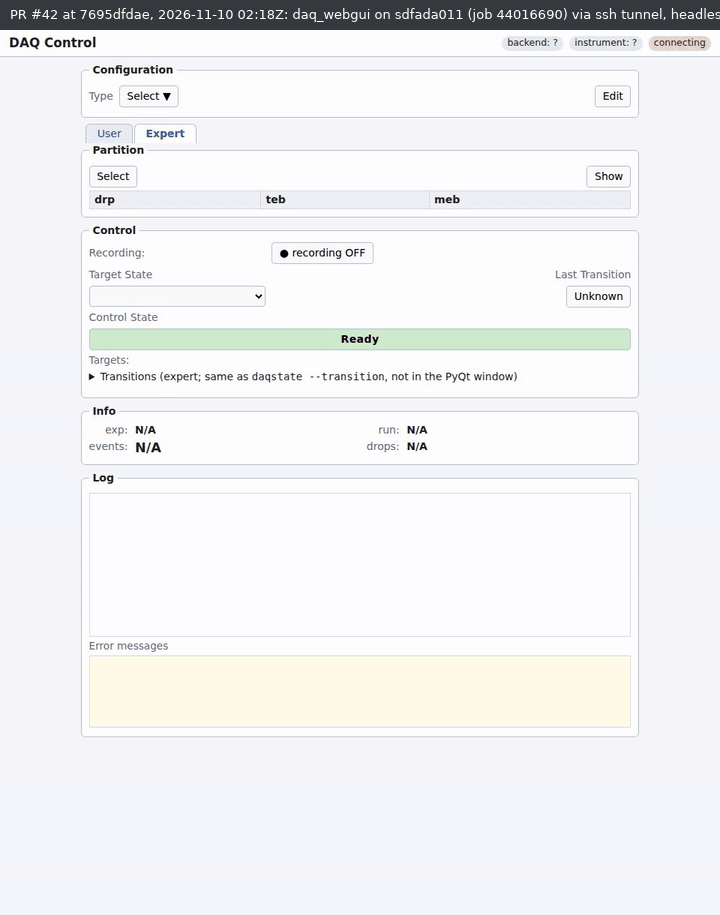

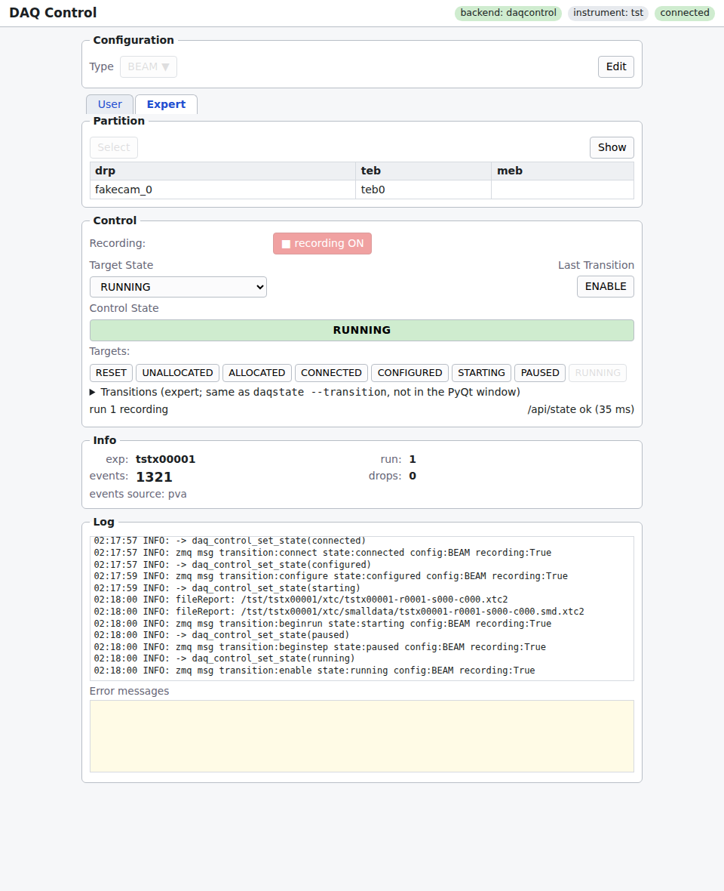

The terminal of that session (the VM's shell: up, tunnel, browser, status and down on the node, tunnel closed on both hops):

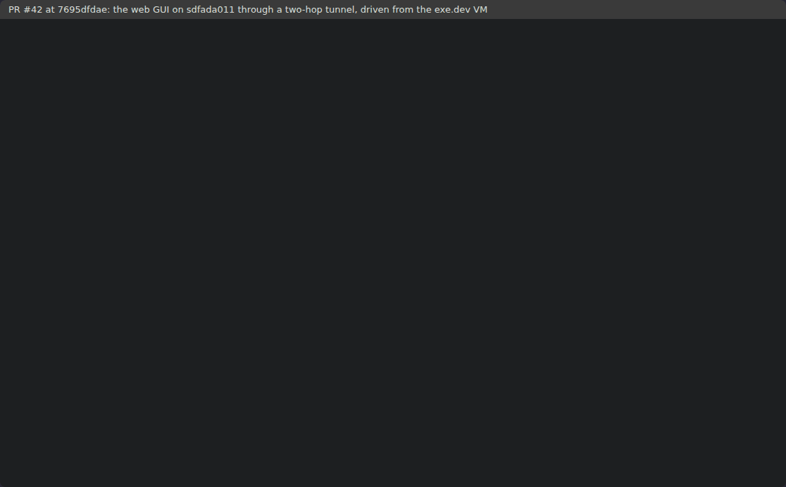

**Recordings.** Made from an exe.dev VM: every command was typed into a headless tmux pane running `ssh -t sdfiana025 bash --rcfile $R/work/fix15/rc.sh -i` ([rc.sh](https://github.com/carbonscott/lcls2/blob/pr-assets/pr42/scripts/fix15/rc.sh)). There `$S` is `srun --jobid=44000948 --overlap -w sdfmilan023 -N 1 --ntasks=1 --cpus-per-task=16 --mem=32G`, `$S2` the same on sdfmilan082, `$G` and `$G13` a GPU step on sdfada010 and sdfada013, so each `$S <script>` line is a new Slurm step; the matrix adds its steps on sdfmilan082 and the GPU node. `git log -1`, the date and the job ids are in the first frames of each. The pane shows the matrix lines `$MXF` picks (every `TYPE`, `PROGRAMS`, `FEATURE` and assertion line; the whole output is in the logs). Each GIF is under 6 MB.

Recording 3 (03:34Z, b14885af3):

**3.1** Jobs; HEAD b14885af3, its 3 commits and diff since 7695dfdae; build state; `420 passed, 1 skipped` (step 347); `cuInit` on sdfada010, 0.06-0.08 s.


**3.2** Matrix run h1 (step 350), two parts: `MATRIX FAIL (3 of 201 assertions failed)` (drp_gpu jungfrau).

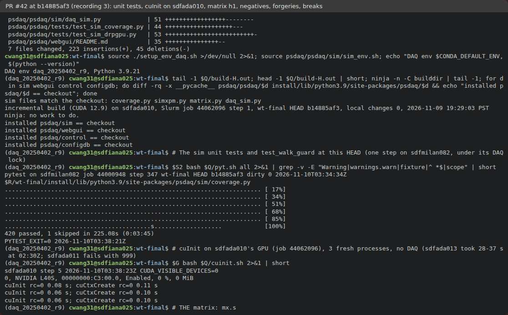

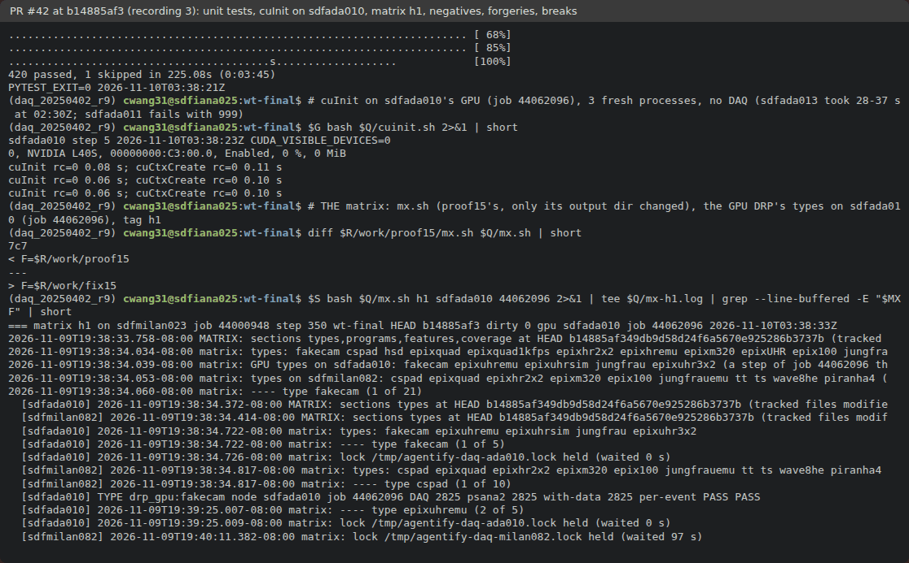

**3.3** Summary; `ready for transitions after <n> s`; coverage negative over h1's records; FG2, FG3 rejected, FG1 accepted.

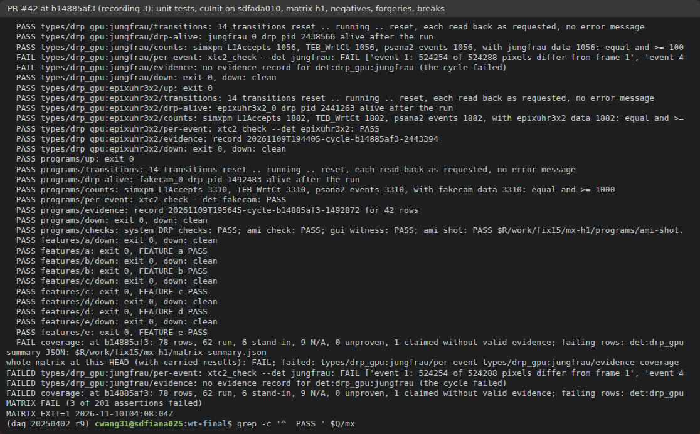

**3.4** The three breaks (step 366), each `exit 1` naming its assertions; checkout clean.

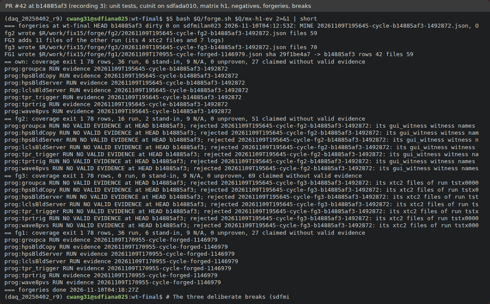

Recording 4 (04:23Z, b14885af3):

**4.1** Jobs; HEAD b14885af3, clean; h1's lost-packet lines; `cuInit` on sdfada013: 10.25, 1.55, 28.50 s (step 283).

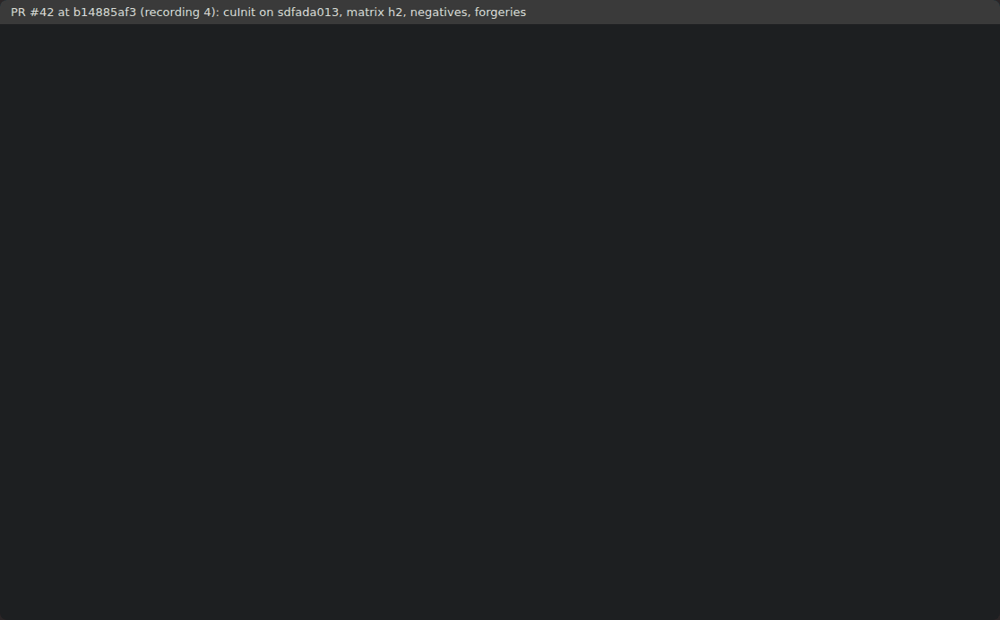

**4.2** Matrix run h2 (step 367, GPU types on sdfada013), two parts: every type and coverage pass, feature c fails: `MATRIX FAIL (1 of 201 assertions failed)`.

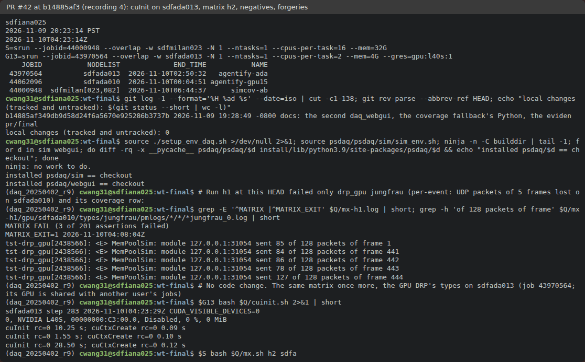

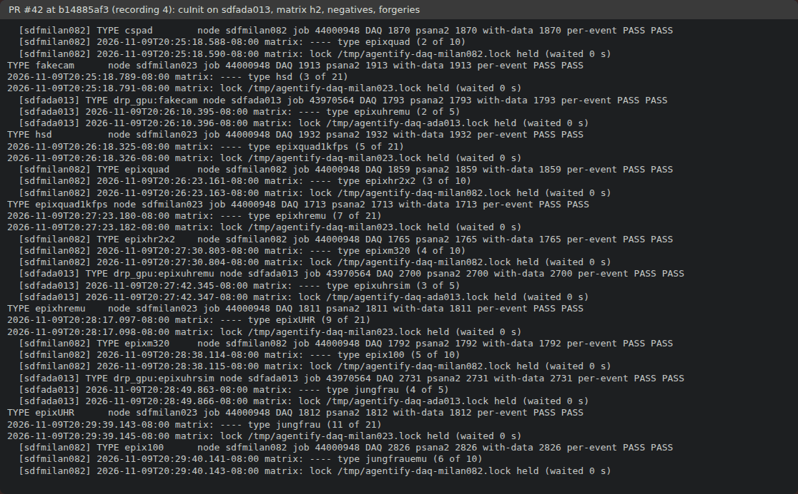

**4.3** Summary; each drp_gpu's `ready for transitions after <n> s` on sdfada013 (31, 20, 7, 20, 73 s).

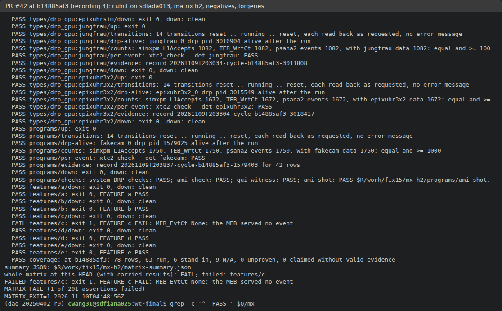

**4.4** Coverage negative over h2's records (exit 1 naming `det:drp:epix100`; the records themselves exit 0); FG2, FG3 rejected, FG1 accepted; checkout clean.

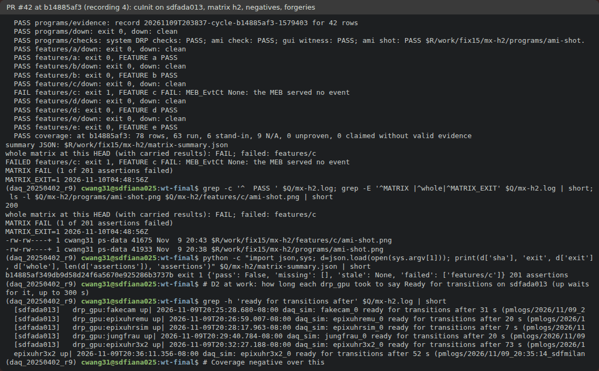

Recordings 1 and 2 (at c370014fc and 7695dfdae, before the fixes: the build, 417 unit tests, runs m1 and m2, the breaks and the hardware path at 7695dfdae): [1 of 7](https://raw.githubusercontent.com/carbonscott/lcls2/pr-assets/pr42/terminal-1.gif), [2](https://raw.githubusercontent.com/carbonscott/lcls2/pr-assets/pr42/terminal-2.gif), [3](https://raw.githubusercontent.com/carbonscott/lcls2/pr-assets/pr42/terminal-3.gif), [4](https://raw.githubusercontent.com/carbonscott/lcls2/pr-assets/pr42/terminal-4.gif), [5](https://raw.githubusercontent.com/carbonscott/lcls2/pr-assets/pr42/terminal-5.gif), [6](https://raw.githubusercontent.com/carbonscott/lcls2/pr-assets/pr42/terminal-6.gif), [7](https://raw.githubusercontent.com/carbonscott/lcls2/pr-assets/pr42/terminal-7.gif).

<sub>The GIFs cap each wait at 1.2 s and hold each finished output 2.5 s, so their clock is not real time. The asciinema casts play at real speed: [recording 3](https://github.com/carbonscott/lcls2/blob/pr-assets/pr42/recording3.cast), [4](https://github.com/carbonscott/lcls2/blob/pr-assets/pr42/recording4.cast), [1](https://github.com/carbonscott/lcls2/blob/pr-assets/pr42/recording1.cast), [2](https://github.com/carbonscott/lcls2/blob/pr-assets/pr42/recording2.cast), [web GUI session](https://github.com/carbonscott/lcls2/blob/pr-assets/pr42/tunnel.cast); transcripts: [3](https://github.com/carbonscott/lcls2/blob/pr-assets/pr42/recording3.txt), [4](https://github.com/carbonscott/lcls2/blob/pr-assets/pr42/recording4.txt), [1](https://github.com/carbonscott/lcls2/blob/pr-assets/pr42/recording1.txt), [2](https://github.com/carbonscott/lcls2/blob/pr-assets/pr42/recording2.txt), [web](https://github.com/carbonscott/lcls2/blob/pr-assets/pr42/tunnel.txt).</sub>

<details><summary>Raw output: the end of matrix run h2 (its summary; the 200 PASS lines are in the log)</summary>

```
$ $S bash $Q/mx.sh h2 sdfada013 43970564 ...      (sdfmilan023 job 44000948 step 367)
=== matrix h2 on sdfmilan023 job 44000948 step 367 wt-final HEAD b14885af3 dirty 0 gpu sdfada013 job 43970564 2026-11-10T04:24:25Z
==== MATRIX SUMMARY at HEAD b14885af349db9d58d24f6a5670e925286b3737b (tracked files modified: False), host sdfmilan023, job 44000948 step 367, 2026-11-09T20:24:25.994-08:00 .. 2026-11-09T20:48:56.880-
types (26):
TYPE ... (26 lines: every type PASS, as in the table above; in the log)
programs:
PROGRAMS fakecam      node sdfmilan023 job 44000948 DAQ 1750 psana2 1750 with-data 1750 per-event PASS PASS
features:
FEATURE a PASS  exit 0, FEATURE a PASS
FEATURE b PASS  exit 0, FEATURE b PASS
FEATURE c FAIL  exit 1, FEATURE c FAIL: MEB_EvtCt None: the MEB served no event
FEATURE d PASS  exit 0, FEATURE d PASS
FEATURE e PASS  exit 0, FEATURE e PASS
coverage: at b14885af3: 78 rows, 63 run, 6 stand-in, 9 N/A, 0 unproven, 0 claimed without valid evidence
assertions: 201, 200 passed, 1 failed
  FAIL features/c: exit 1, FEATURE c FAIL: MEB_EvtCt None: the MEB served no event
summary JSON: $R/work/fix15/mx-h2/matrix-summary.json
whole matrix at this HEAD (with carried results): FAIL; failed: features/c
FAILED features/c: exit 1, FEATURE c FAIL: MEB_EvtCt None: the MEB served no event
MATRIX FAIL (1 of 201 assertions failed)
MATRIX_EXIT=1 2026-11-10T04:48:56Z
```

</details>

<details><summary>Raw output: the breaks (recording 3, step 366; each break's first FAILED line, the rest in its log), the coverage negative and the forgeries (recording 4, over h2), at b14885af3</summary>

```
=== breaks h1 on sdfmilan023 job 44000948 step 366 wt-final HEAD b14885af3 dirty 0 2026-11-10T04:18:34Z
BREAK register exit 1: MATRIX FAIL (5 of 7 assertions failed)
FAILED types/epix100/transitions: setState configured -> error; setState allocated -> connected; status stream error: epix100_0 did not re
BREAK kill-drp exit 1: MATRIX FAIL (5 of 7 assertions failed)
FAILED types/fakecam/transitions: setState paused -> running; status stream error: teb0 did not respond to disable; status stream error: f
BREAK corrupt exit 1: MATRIX FAIL (2 of 7 assertions failed)
FAILED types/fakecam/per-event: xtc2_check --det fakecam: FAIL ['event 500: payload pattern broken: 1 of 60 payload words differ, first la
=== breaks done 2026-11-10T04:22:34Z

=== coverage negative at wt-final HEAD b14885af3 dirty 0: 32 records in $R/work/fix15/mx-h2-ev
COVERAGE without det:drp:epix100: exit 1
det:drp:epix100                RUN       NO VALID EVIDENCE at HEAD b14885af3
78 rows, 62 run, 6 stand-in, 9 N/A, 0 unproven, 1 claimed without valid evidence
FAIL: 0 error(s), 1 RUN/STAND-IN row(s) without valid evidence, 0 unproven row(s)
COVERAGE over the matrix's evidence: exit 0
78 rows, 63 run, 6 stand-in, 9 N/A, 0 unproven, 0 claimed without valid evidence
status file claims (not counted above unless proven): 63 RUN, 6 STAND-IN, 9 N/A
PASS

=== forgeries at wt-final HEAD b14885af3 dirty 0 on sdfmilan023 2026-11-10T04:52:58Z: MINE 20261109T203837-cycle-b14885af3-1579403.json, O
FG3 adds 11 files of the other run (its 4 xtc2 files and 7 logs)
FG1 wrote $R/work/fix15/forge/fg1/20261109T170955-cycle-forged-1146979.json sha 29f1be4a7 -> b14885af3 rows 42 files 59
== own: coverage exit 1 78 rows, 36 run, 6 stand-in, 9 N/A, 0 unproven, 27 claimed without valid evidence
prog:hpsBldServer RUN evidence 20261109T203837-cycle-b14885af3-1579403
== fg2: coverage exit 1 78 rows, 16 run, 2 stand-in, 9 N/A, 0 unproven, 51 claimed without valid evidence
prog:hpsBldServer RUN NO VALID EVIDENCE at HEAD b14885af3; rejected 20261109T203837-cycle-fg2-b14885af3-1579403: its gui_witness witness names no listed xtc2 file of run tstx00001/r0001
== fg3: coverage exit 1 78 rows, 0 run, 0 stand-in, 9 N/A, 0 unproven, 69 claimed without valid evidence
prog:hpsBldServer RUN NO VALID EVIDENCE at HEAD b14885af3; rejected 20261109T203837-cycle-fg3-b14885af3-1579403: its xtc2 files of run tstx00001/r0001 have 2 different BeginRuns (1163120920.815554022, 1163133458.539332171): a record is one run, so it cannot list another run's files
== fg1: coverage exit 1 78 rows, 36 run, 6 stand-in, 9 N/A, 0 unproven, 27 claimed without valid evidence
prog:hpsBldServer RUN evidence 20261109T170955-cycle-forged-1146979
=== forgeries done 2026-11-10T04:57:49Z
```

</details>

### What to know (disclosures and judgment calls)

- **GPU nodes** ("Why m2's GPU types failed" above). h2, where all 5 GPU types passed, ran them on the slow-starting sdfada013. drp_gpu ran from a build with conda-forge's CUDA 12.9 toolkit (no toolkit on the nodes; RUNBOOK §3h); `DAQ_SIM_CUDA_LIB` gives procServ's drp_gpu its `libcudart`.
- **drp_gpu jungfrau's UDP loss (h1).** simsls sends each frame as 128 UDP packets on loopback; in h1 on sdfada010 the DRP got 78 to 127 of 128 for 5 frames (`DRP_Damage 5`) and the per-event check failed 3 events. The same `sent N of 128 packets` lines are in the first full matrix (5a6387ea1, jungfrau at 1 kHz, drp and drp_gpu); no other jungfrau DRP log under the campaign's `work/` has them. Not fixed here; the DRP marks the events damaged and the check catches them.
- **Rulings** (each defined in RUNBOOK §3d and applied by `daq_sim coverage`): R1 (an AMI row counts from an `ami_check` witness), R2, R2b, R2c (GUI and monitor rows from `gui_witness`), R3 (a PV server is STAND-IN when a stand-in serves every PV name its source defines), R3b (a program that serves its own PVs is RUN when the witness lists every PV name its source defines and one PV takes a put and a put-back), R4 (a device GUI is RUN on a device stand-in), R4-stimulus (deadca's changing values come from deadtime the cycle causes, `SIM:LinkFull`, recorded as `stimulus`), R5 and R5-interp (`daqstat` is RUN on **simslurm, a Slurm stand-in: no real Slurm controller is queried**; 2 or more refreshes must match an independent read of simslurm within 1.5 s), R6, R6-clarify (tt and epixhr2x2 run with `PSDAQ_SIM_PYTHONPATH` naming third-party library builds already on the site, env-only and off by default; their config code runs with no sim-only edit; both fail the same way at base without it), R6b (`wave8pvs` runs in the site env ps-4.5.16 with the site's wave8-1.0.1 source unpacked under the run dir), R6-programs (production fixes that make a program start, shown base vs head: hpsBldServer, hpsBldCopy, wave8pvs), R7 (N/A for a program the tree cannot build, cited by file and line: `xpmPVs`, `hsd64PVs`), **R7b, a judgment call** (N/A for a program whose import exists nowhere on the site; it was proposed for wave8pvs, which then ran under R6b, so no row uses it at this head), R8 (TPR-card programs RUN on a simulated card, `PSDAQ_SIM_TPR`, off by default), R9 (a stand-in may listen on all interfaces of a campaign node on a non-production port: simhps's RSSI server; the program addresses it by 127.0.0.1). **COV-LIMIT: coverage is an evidence-binding check, not a security boundary.** Removing evidence fails it (shown above). The commit binding is the record's own `sha` field and records are not signed, so cheap forgeries pass: an older commit's record with only its `sha` changed is accepted for all its rows (a reviewer's FG1: the 29f1be4a7 programs record gave 42 rows at c370014fc, and again at this head, above), and a witness or log rewritten and re-hashed would pass. A record that also listed another run's witness, xtc2 files and program logs, unchanged (FG3), was accepted for tprtrig, tpr_trigger, lclsBldServer, hpsBldServer, hpsBldCopy and wave8pvs at c370014fc, because every daq_sim run is run tstx00001/r0001 and lo/hi spanned both runs' L1Accepts; d50c276a7 now rejects it (a record's xtc2 files of its run must have one BeginRun; all 58 records of m1 and m2 have one), as the GUI rows' procmgr-instance check already did. RUNBOOK §3d says what the rules catch and what still passes.
- **Stand-ins** (the 6 STAND-IN rows): simxpm for `pyxpm` and `pykcuxpm` (the XPM's PVs and control port), simhsd for `hsdpvs` and `hsd134PVs`, simtpr for `tprcas` and `tprioc`. Device stand-ins behind RUN rows: `rogue_dev` (every BEB board), `simsls` (jungfrau's slsDetector servers), `simhsdioc`, `simdti`, `simhps` (the HPS crate), `calibws_server` (the calibration web service), the `softIoc` stand-in IOC, simulated TPR cards, simslurm.
- **MonTracker race, fixed only on the sim side.** `drp_pva`'s `MonTracker` (production) starts its monitor in its constructor and drops an update that arrives before the constructor returns (`shared_from_this()` throws `bad_weak_ptr`); pvAccessCPP then signals no later update. On loopback simxpm's camera PV answered within 1 ms, so drp_pva sometimes failed Configure ("PV DAQ:SIM:CAM:IMAGE hasn't connected"). The camera PV now opens 0.25 s after a client's first channel (145f3da63). The production race is left as it is; it could happen on hardware too. Reproduced with c370014fc's code by a reviewer: with another client holding `DAQ:SIM:CAM:IMAGE` open before drp_pva's first Connect (as a camera IOC's PV is) and strace on drp_pva, 6 of 6 Configures failed (`hasn't connected`); with strace and no other client, 0 of 4. So 145f3da63 avoids the race only while drp_pva is the PV's first client.
- **drp_gpu and drp abort at shutdown.** After `down`, drp_gpu (and some CPU DRPs) end with `double free or corruption` / `free(): double free` and signal 6 at the SIGINT shutdown, after the run and the Reset check. It is present at the base 5aaf09617 (the types branches' base runs end the same way) and not fixed here.
- **tt's AppLane settings are skipped.** `tt_config`'s `rogue_translate` has no `AppLane` entry, so `config_expert` prints `Lookup failed for node [AppLane]` at every Configure and those settings are not written, on hardware too (RUNBOOK §3l; d27f657f0). Not fixed here.
- **jungfrau runs at 100 Hz** (its RUNBOOK §3j rate, fe85cb883). At 1 kHz its DRP fell behind the module stand-in (the first full matrix at 5a6387ea1 failed 6 assertions, all jungfrau).
- **One unexplained `procmgr stop` timeout.** In one programs run during the camera-PV fix (before 12 programs runs that passed in a row), `procmgr stop` timed out at `down` (`subprocess.TimeoutExpired`, `work/finalinteg/prog-fix3-023-a/m1.log` line 228); drp_pva was fine in that run, and it did not happen again.
- **BLD layout oddities** (RUNBOOK §3d, not fixed): each HPS event's payload after its `valid` word is its severity word, not its channel data (`HpsEvent::sevr` sits between `channels` and the data since c41b8a44b), and `Pds::Bld::Server` writes the pulse ID before the time stamp, the other way round from drp_bld's LCLS-II layout, so hpsBldCopy's Client takes the time stamp for the pulse ID.
- **Merge decisions.** ce2bd2cfe: pr/stack's served-value rule (a GUI's or monitor's reads must match what a stand-in logged it served) leaves out the witnesses of pr/tail3 (lclsBldServer's packets, the HPS chain, wave8pvs's own PVs), which no stand-in serves and which their own checks (`bld_problem`, `hps_problem`, `pvs_problem`) cover, as it already left out a TPR card's registers and an R3b program's own PVs; the merged status file marks the `det:drp_gpu` rows RUN. 09f5fe236: pr/stack's procmgr-instance rule covers the GUIs and monitors, not pr/tail3's servers. While merging, simxpm's `PAddr`, `RxAlign` and `SFPSTATUS` PVs (added on both sides) were kept once.
- **A cold reader** (a fresh agent with only the docs at c370014fc, its own DAQ on sdfada011): verdict **usable**. It built, recorded run 1 with 1942 L1Accepts, read it back with psana2 (PASS), got live values from a second web GUI (`/api/pvgui/values?gui=pvant`: `NumL0Acc` 12885 → 15885 in 3 s) and took the DAQ down. Fixed in b14885af3 from its friction list: how to stop the second `daq_webgui` (`DAQ_SIM_WORKDIR=$WD`, so `daq_sim down` stops it), its environment (`sim_env.sh`), its value routes (`/api/pvgui/values`, `/api/pvgui/spec`, `/api/procstat/status`, ...), which Python runs the coverage fallback on sdfiana025 (its `python3` is 3.6), the evidence line (`prog:pykcuxpm`), fetching this PR's head (`git fetch origin pull/42/head:pr-42`), the harmless Open MPI lines on a GPU node, and RUNBOOK §7's stale lines (xpmpva runs; the web GUI tunnel was tested through sdfiana025). Left: headless Chromium hangs on sdfada011's GPU node (a GPU child in D state); the RUNBOOK names only milano nodes (an ada node with `--overlap` and fewer CPUs worked); the browser venv is a 600 MB one-time setup; the RUNBOOK is 1700+ lines.
- **Review.** skeptic15 reviewed c370014fc with its own DAQ on sdfada011 (job 44016690): its D2 (GPU types without a ready wait) and D3 (another run's files spliced into a record) are fixed here, its body edits are applied, and its D5 (MonTracker) is the disclosure above. The three commits of this head have had no second review yet.

### Not run

- **A run of THE matrix with exit 0 at this head.** h1 failed 3 of 201 (drp_gpu jungfrau, UDP loss on sdfada010) and h2 1 of 201 (feature c, the MEB's counters not read); each failure passed in the other run. A third run was not made (one rerun was allowed). The last run with exit 0 is at 29f1be4a7 (`MATRIX PASS (201 assertions)`, 2026-11-10 00:54-01:21Z), before the three fixes and the CHANGELOG links.
- No hardware: everything ran against stand-ins and emulated devices; the hardware path above shows only that the commands a hardware run takes behave as at base.
- `xpmPVs`, `hsd64PVs` (R7), `hsdca`, `hsdcas`, `xpmpvas`, `tmo_acr_opal_feedback` (no source in the tree), `cLoopTest`, `qLoopTest`, `qRead` (pgpGen4Daq card diagnostics, no role in a DAQ run) are N/A, each with the file and line coverage prints.
- The web GUI's `/gui/<name>` pages were not part of these recordings (PRs #31, #35, #37 and #40 have theirs); the web GUI run above is at 7695dfdae (the web GUI's code is unchanged since; its README changed).
- The GPU DRP's rate limits (33 kHz on hardware) are not exercised: a host thread copies the payload at simxpm's rate (RUNBOOK §7).
- No fresh `build_all.sh -f` at this head (incremental: no C++ changed since the fresh CUDA build of this branch, bfc1ccd3d). The hardware path was not rerun at this head (no non-sim code changed since c370014fc).
- No CI run is shown here (below).

### To rerun

```
# on sdfiana025, in the campaign root ($R); scripts in pr-assets/pr42/scripts and scripts/fix15
S="srun --jobid=44000948 --overlap -w sdfmilan023 -N 1 --ntasks=1 --cpus-per-task=16 --mem=32G"
srun --jobid=44062096 --overlap -w sdfada010 -N 1 --ntasks=1 --cpus-per-task=16 --mem=32G --gres=gpu:l40s:1 bash build.sh H   # CUDA 12.9 build
$S bash pyt.sh all                                  # unit tests, under the node lock
srun --jobid=43970564 --overlap -w sdfada013 -N 1 --ntasks=1 --cpus-per-task=2 --mem=4G --gres=gpu:l40s:1 bash cuinit.sh   # CUDA init time
$S bash mx.sh <tag> sdfada013 43970564              # THE matrix (RUNBOOK 3p); MATRIX_EXIT=0 expected
$S bash covneg.sh $R/work/fix15/mx-<tag>-ev det:drp:epix100   # negative exit 1, the evidence itself exit 0
$S bash forge.sh $R/work/fix15/mx-<tag>-ev          # FG2, FG3 rejected; FG1 accepted
$S bash brk.sh <tag>                                # the three breaks, each exit 1
# the recordings: python3 mksteps_h.py h1; python3 mksteps_h2.py h2; python3 recdrive.py pr42-term3 steps/pr42-term3-h1.json
# (and pr42-term4); render_split.py (with --no-sandbox, --disable-gpu, --disable-dev-shm-usage), splitgif.py (redo/ toolkit)
```

## Checklist

- [x] Did you update `CHANGELOG.md` with your changes? (every branch's entries, each linking #42 at this head)
- [x] Does the PR clearly describe the problem and the solution?
- [ ] Do all GitHub Actions checks pass on this PR? CI: (orchestrator fills)
- [ ] Does the PR use "Fix #XXX" notation to tell GitHub to close the relevant issue numbered XXX when the PR is merged? (no issue)
